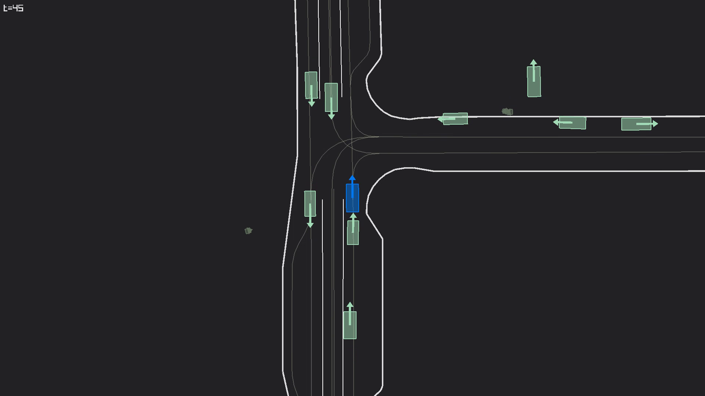

# Reproduce the spiced self-play result

Starter for the key result in [Human-like autonomy emerges from self-play and a pinch of human data](https://arxiv.org/abs/2606.19370): a regularized self-play policy keeps a high self-play score and a low self-play collision rate, and it collides less often, at-fault, with held-out human replays.

```bash
python reproduce/eval.py
python reproduce/render.py
```

`eval.py` scores both checkpoints on the first 128 maps of the held-out validation split. `render.py` drives the regularized policy through the three Waymo scenes in `reproduce/data/`.

## Result on the 128-map slice

One stochastic pass of `python reproduce/eval.py` (first 128 validation maps, 1024 agents, seed 1):

| Policy | Self-play score | Self-play collision | Human-replay at-fault |
| --- | --- | --- | --- |
| Regularized | 0.971 | 0.38% | 0.29% |
| Unregularized | 0.981 | 1.40% | 1.37% |

Self-play used 153 scenes. Human replay used 1024 scenes. The regularized policy is the low self-play collision rate and the low human-replay at-fault rate.

The same protocol on the full 10k validation split (`results/checkpoint_eval_result_20B_all_det_false.csv`, about 10k human-replay episodes) is:

| Policy | Self-play score | Self-play collision | Human-replay at-fault |
| --- | --- | --- | --- |
| Regularized | 0.975 | 0.47% | 0.91% |
| Unregularized | 0.986 | 0.92% | 1.60% |

The paper's Table 1 reports the 30-minute policy near 0.2% self-play collision and 0.7% human-replay at-fault. Figure 1 quotes 0.6% at-fault. Rates on the 128-map slice move around those numbers. The ordering is the same: regularized self-play stays safe in self-play and is more compatible with human replays.

Eval settings match `examples/analyze.py`: stochastic actions, episode length 200, no observation noise, lambda fixed to the value stored in the checkpoint. Self-play is `control_vehicles`. Human replay is `control_sdc_only` (the ego is the policy, everyone else follows the log).

## Policies

Both files are the 20B-step runs behind the result tables. Each is about 2.5 MB.

| Role | File | Training |
| --- | --- | --- |
| Regularized (ours) | `reproduce/policies/reg_delta_50k_maps_anchor_200_maps.pt` | 50k self-play maps, lambda **0.075**, behavioral-cloning anchor on 200 scenarios (about 30 minutes, 18k human transitions) |
| Unregularized | `reproduce/policies/unreg_delta_50k_maps.pt` | 50k self-play maps, lambda 0 |

The regularized file is the same weights as `models/scaling_cpts/reg_delta_50k_maps_anchor_200_maps.pt` and `models/lambda_ablation/reg_lam_0.075_20B.pt`. The unregularized file is the same weights as `models/scaling_cpts/unreg_delta_50k_maps.pt` and `models/lambda_ablation/reg_lam_0.0_20B.pt`.

`models/best_cpts/` has older copies with the same names. Those are not the table checkpoints: the 1,200-map and 12,000-map files there were trained for 10B steps, and the 200-map and unregularized files there are different 15B–20B runs.

This regularized checkpoint is the paper's method: the 30-minute anchor with lambda 0.075. The repo's main comparison labels `reg_delta_50k_maps_anchor_200_maps.pt` as "Regularized (ours)".

## Full 10k validation split

The paper's test numbers use the 10,000 held-out Waymo Open Motion validation scenarios. Download that release from Hugging Face:

https://huggingface.co/datasets/daphne-cornelisse/pufferdrive_womd_val

```bash
uv pip install -U "huggingface_hub[cli]"
huggingface-cli download daphne-cornelisse/pufferdrive_womd_val \
  --repo-type dataset \
  --local-dir data/processed/validation
```

Convert the JSON into the simulator's binaries. The output directory is `resources/drive/binaries/validation/` (`map_000.bin` through `map_9999.bin`):

```bash
python -c "from pufferlib.ocean.drive.drive import process_all_maps; process_all_maps(data_folder='data/processed/validation', max_maps=10000)"
```

`python reproduce/eval.py` then samples `map_000.bin` through `map_127.bin` from that directory. `--num-maps` and `--num-agents` change the slice.

Rendering does not need this download. The three scenes below are already converted.

## Bundled scenes and rendering

`reproduce/data/` has three interactive WOMD validation scenes, chosen because the ego moves through an intersection with several nearby vehicles. `scenes.json` records the Waymo ids.

| Map | Waymo scenario id | Source file |
| --- | --- | --- |
| `map_000.bin` | `f2e32390fb9fc73a` | `tfrecord-00010-of-00150_215.json` |
| `map_001.bin` | `3810e617bb1f0c2d` | `tfrecord-00014-of-00150_101.json` |
| `map_002.bin` | `be141957a08e978e` | `tfrecord-00021-of-00150_242.json` |

```bash
python reproduce/render.py
python reproduce/render.py --scene 1
python reproduce/render.py --mode self_play --policy unregularized
```

The default is human replay with the regularized policy: logged partners, greedy ego actions, 91 steps (the Waymo clip). ffmpeg writes `reproduce/videos/map_00N_human_replay.mp4` and a mid-clip png. The blue vehicle is the ego. Pale green vehicles are human replays. The green circle is the ego goal.

Scene 1 (`map_001.bin`), mid-clip:


